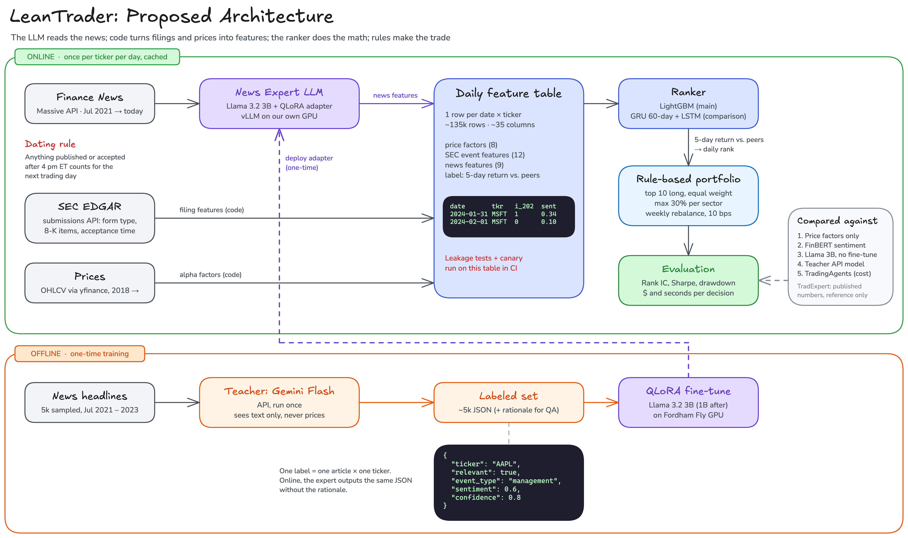

# LeanTrader
Cost efficient and faster framework for Market Research and Stock Recommendation

## Architecture



A fine-tuned Llama 3.2 3B reads the news. Plain code turns SEC filings and prices into features.
LightGBM (main), a GRU over a 60-day window and an LSTM (comparison) rank the stocks, and fixed rules
make the trade. Offline, a Gemini Flash teacher labels news once to fine-tune the 3B model.

To edit the diagram, open `docs/leantrader-architecture.excalidraw` in [excalidraw.com](https://excalidraw.com),
then export it over `docs/leantrader-architecture.png`.

## Setup

Python 3.11 or newer.

```bash
python -m venv .venv
source .venv/bin/activate          # Windows: .venv\Scripts\activate
pip install -r requirements.txt
pip install -r requirements-ml.txt # only if you run model scripts (FinBERT, Llama)
pytest                             # should pass before you start
```

**Adding a package?** Put it in `requirements.txt` (core) or `requirements-ml.txt` (GPU/model)
with a minimum version, `package>=X.Y`, where X.Y comes from `pip show <package>`.
A test blocks the merge if you forget, and Claude's review flags it (rule in `CLAUDE.md`).

## Shared pieces (use these, don't rewrite them)

**Universe.** `configs/universe.csv` holds the 100 tickers (S&P 100 as of the Sept 2026 rebalance, minus GOOG).
Columns: `ticker`, `company`, `cik`, `sector`, `aliases`, `past_tickers`.

```python
from universe import load_universe, tickers
uni = load_universe()      # DataFrame, every column as text
syms = tickers()           # ['AAPL', 'ABBV', ...]
```

- Use `ticker` spelling everywhere (`BRK-B`, not `BRK.B`).
- `aliases` are the names headlines use, `;`-joined. Use them for the news `in_title` check.
- `past_tickers` are older tickers of the same company (BNY was `BK` until May 21, 2026; META was `FB`).
  Query them too when pulling old news or prices, then map rows back to `ticker`.

**Dating rule.** Every table sets `decision_date` with this function and nothing else.

```python
from dating import decision_date, trading_days
news["decision_date"] = decision_date(news["published_utc"])   # UTC strings ending in Z
```

Before 4:00 pm New York time on a trading day means that day; 4:00 pm or later means the next
trading day; weekends, holidays and special closures roll forward. Timestamps without a timezone
are refused on purpose.

## Folders

```
configs/        universe.csv (committed)
docs/           architecture diagram (.excalidraw source + .png for the README)
data/raw/       raw API responses, one folder per source (gitignored)
data/interim/   our output CSVs (gitignored; share through the team folder)
tests/          one test file per table
```

## News (Nati)

`news.py` pulls news from three sources and merges them. Each pull is cached under
`data/raw/<source>/`, so a rerun skips what you already have.

| Source  | Dates                          | Needs                           |
|---------|--------------------------------|---------------------------------|
| FNSPID  | 2018-01-01 to 2023-12-31       | nothing (public Hugging Face dataset), `pip install -r requirements-ml.txt` |
| Massive | about the last 2 years         | `MASSIVE_API_KEY`               |
| Alpaca  | recent news (~Apr 2026 onward) | `APCA_API_KEY_ID`, `APCA_API_SECRET_KEY` |

No free source we have tried covers 2024-01-01 to about Nov 2024. FNSPID ends in 2023, the free
Massive plan reaches only about 2 years back, and our Alpaca pull starts at Apr 29, 2026. The
public FinMultiTime dataset (Nasdaq news to 2025) has the same hole: AAPL and KO have no
articles in Jan–Oct 2024.

**Filling the 2024 gap (needs API keys):**

```bash
python news.py probe-2024                      # 1 request per API: do your keys reach Mar 2024?
python news.py pull-alpaca --gap-2024          # if the Alpaca line shows articles (free)
python news.py pull-massive --gap-2024 --gap-seconds 0.2   # or: Massive Stocks Starter ($29/mo, 5y history)
python news.py add-external                    # merge into news_clean.csv; no other caches needed
```

The gap pulls go to `data/raw/alpaca_2024/` and `data/raw/massive_2024/`. Each keeps its own
`source` name and is clipped to 2024-01-01 to 2024-11-22 (New York time), the day before the
main Massive cache starts. Rerunning `add-external` replaces earlier gap and external rows
instead of stacking them. Existing rows are never dropped or edited.

**External gap-fill (added Nov 27 by MJ).** 179 ticker-years (2018 to Oct 2024) had fewer than
10 articles, not counting years before a company listed. An external backfill added 8,333 rows
for them, all marked by `source`. Any value other than `fnspid`, `massive` or `alpaca` is
external:

- **Public news datasets:** `drinkall_yahoo` (6,391), `dolphin_polygon`, `finmultitime_nasdaq`
  and `investopedia`.
- **Publisher pages** found in public archives, sitemaps and RSS: `public_<publisher>`, such as
  Reuters, CNN, AP, TheStreet and Zacks, plus 12 `issuer_release` rows.

No news API or Nexis was used. Each `published_utc` is the publisher's or dataset's own time.
Records with only a date were left out. Files:

- `data/raw/external/addon_cumulative_delta.csv`: the rows, in the `news_clean.csv` layout.
- `data/raw/external/provenance/`: audit files with publisher, date evidence and method.

`news_id` is re-derived from the URL with our own ID rule. In-title, de-dup and daily-cap
flags are recomputed with the same rules as every other source.

- `python news.py build` includes these files automatically.
- `python news.py add-external` merges them into an existing `news_clean.csv` without the raw
  caches. No existing row is dropped or edited. Only `keep` can change, where a new article
  outranks an old one under the daily cap: that happened to 1 row, an off-topic LLY FNSPID item.
- **Result:** all 179 ticker-years now have at least 10 kept articles (median 12, minimum 10),
  and 7,736 of the 8,333 new rows are kept. That's still thin next to about 400 for a normal
  ticker-year, so a 10-article year doesn't mean year-round coverage.
- **Most new rows are headlines only** (`summary` empty).
- **Possible selection bias.** The publisher pages were searched for in 2026 and favor
  company events, so they may lean toward stories that turned out to matter. Report results
  with and without external rows.
- **The Jan–Oct 2024 gap is still open** for the 64 tickers not on the gap list: 142 kept rows
  in total, a median of 2 per ticker, and none for SNDK.
- **We didn't use the backfill's own full `news_clean.csv`.** It deleted 8,182 existing rows,
  54 of them kept, and changed `keep` on 6 more. The spec says never drop rows.

**Nexis Uni (`source = NexisUni`, added Nov 27 by MJ).** English news bulk-downloaded from
Nexis Uni through Fordham fills thin ticker-months. The download plan, by priority, is in
`NexisUni/plan/` next to the repo: `nexis_download_brief.md` and `nexis_download_plan.csv`.
`nexis_import.py` turns the DOCX exports into a batch, and `add-external` merges it:

```bash
python nexis_import.py --batch nexisuni_batch02 --plan ../NexisUni/plan/nexis_download_plan.csv \
    LIN="../NexisUni/Files (500).DOCX" DUK="../NexisUni/Files (149)"
python news.py add-external
```

- **What's kept.** Only English news about the company passes. Press releases and
  regulatory/government feeds are dropped, as are machine-written holdings pages (MarketBeat-type
  sites) and other entities with the same name (Linde India, cricketer George Linde, ...). The
  company must be in the headline or lead, the date must fall in the plan's ranges, and repeat
  copies are skipped.
- **What's stored.** Only the headline and a lead of at most 500 characters, never the full
  text. The `url` is the Nexis document link.
- **Timestamps.** The article's own date line is used, with the zone's standard offset (never
  earlier than the truth). Date-only items and "12:00 AM" stamps count from the next trading day.
- **Audit log.** `data/raw/external/provenance/<batch>_meta.csv` records every downloaded article
  as kept or excluded, with the reason.
- **Batch 1** (LIN and DUK, P1 window): 949 downloaded articles, 85 kept (59 LIN, 26 DUK).
  Exclusions: 460 press releases or government feeds, 174 holdings-site pages, 169 duplicates
  across the four export files, 21 not about the company in the headline or lead, 28 sport or
  politics items, 6 other entities, and a few others. Kept LIN articles went from 11 to 26 in
  2025, and DUK from 5 to 12.

**API keys.** Copy the template and fill in your own keys. `.env` is gitignored, so never commit it.

```bash
cp .env.example .env
```

- Massive: sign up at [massive.com](https://massive.com); the free plan's key works.
- Alpaca: sign up at [alpaca.markets](https://alpaca.markets), then Dashboard → API Keys
  (paper-trading keys work for news).

`news.py` reads `.env` when it starts. Keys you export in the shell take priority.

```bash
python news.py pull-fnspid                       # Benzinga file, to Jun 2020 (5.7 GB download)
python news.py pull-fnspid --file nasdaq-lite    # Nasdaq file, to 2023 (1.8 GB)
python news.py pull-massive                      # add --tickers AAPL,MSFT to pull a few
python news.py pull-alpaca
python news.py build                             # -> data/interim/news_clean.csv, news_coverage.csv
```

You only need keys if you pull news yourself. The finished CSVs are shared through the team folder.

## Building the universe (MJ, once)

```bash
python universe.py --email you@fordham.edu   # adds CIKs from SEC, writes configs/universe.csv
pytest tests/test_universe.py                # the CIK test runs once the CSV exists
```
